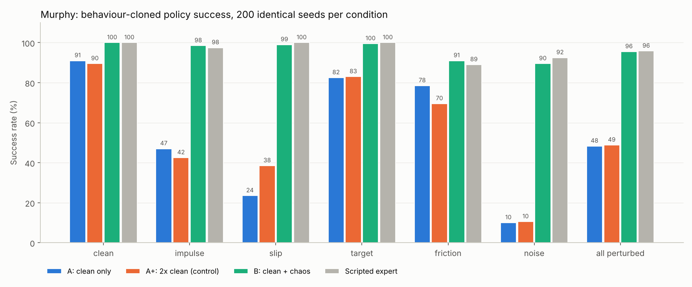

# Murphy: failure-and-recovery data for robot policies

Robot policies trained by imitation only ever see an expert doing things right, so the moment the world deviates (a cube gets knocked, a grasp slips) they are in states they have never seen and they fall apart. Real failure data is slow, expensive and risky to collect on hardware. Murphy uses a MuJoCo simulation to inject failures on purpose, records a closed-loop expert recovering from them, and shows that a policy trained on that recovery data is far more robust than one trained on clean demonstrations alone.

## Pipeline

```
 env.py                expert.py                 chaos.py
 MuJoCo tabletop  -->  closed-loop scripted  <-- perturbations at a random step:
 mocap gripper,        state machine, re-plans    impulse | slip | target jump |
 cube, target          from current obs           friction drop | action noise
        \                     |                      /
         \                    v                     /
          `------------>  generate.py  <-----------'
                    multiprocessing rollouts -> Parquet, one row per step
                    data/clean.parquet   data/chaos.parquet   data/clean_extra.parquet
                                   |
                                   v
                             train.py  (behaviour cloning, MLP, MSE, normalised obs)
                    A = clean   |   B = clean + chaos   |   A+ = 2x clean (control)
                                   |   same gradient steps and batch for all
                                   v
                             eval.py   200 held-out seeds x {clean + 5 perturbations}
                                   |   identical seeds and perturbations for every policy
                                   v
                results/results.json, results/success_rates.png, demo.py videos / live viewer
```

## Setup

Python 3.11, CPU only.

```bash
uv venv --python 3.11 .venv
```

```bash
uv pip install --python .venv/bin/python -r requirements.txt
```

On a headless Linux box, video rendering uses EGL (`MUJOCO_GL=egl` is set automatically by `demo.py video`); you may need `apt-get install libegl1 libgl1`.

## Running each step

All scripts have fixed seeds and sensible defaults. Times are on a 4-core CPU.

| step | command | what it does | time |
|---|---|---|---|
| 1 | `.venv/bin/python env.py` | smoke test: resets + random actions | 2 s |
| 2 | `.venv/bin/python expert.py` | expert success over 100 clean episodes | 10 s |
| 3 | `.venv/bin/python chaos.py` | expert success under each perturbation (100 eps each) | 1 min |
| 4 | `.venv/bin/python generate.py` | 2000 clean + 2000 chaos + 2000 clean_extra episodes to `data/` | 75 s |
| 5 | `.venv/bin/python train.py` | trains A, B, A+ (20k steps, batch 512 each) to `models/` | 5 min |
| 6 | `.venv/bin/python eval.py` | 200 seeds x 6 conditions x 4 policies, writes `results/` | 80 s |
| 7a | `.venv/bin/python demo.py video --perturb impulse` | side-by-side A vs B MP4 in `results/` | 40 s |
| 7b | see below | live viewer, policy B, drag the cube | |
| extra | `.venv/bin/python summarize.py` | markdown results table (incl. extra training seeds) | 1 s |
| extra | `./loo.sh` | leave-one-out: train B without type X, test on X | 10 min |

Extra training seeds: `.venv/bin/python train.py --seed 1 --out models_seed1` then `.venv/bin/python eval.py --policies A Aplus B --models models_seed1 --out results/seed1`.

### Live viewer

macOS (the passive viewer must run under `mjpython`, which ships with the mujoco wheel):

```bash
.venv/bin/mjpython demo.py live --policy B
```

Linux / Windows:

```bash
.venv/bin/python demo.py live --policy B
```

Double-click the cube to select it, then hold Ctrl and right-drag to shove it across the table (Ctrl + left-drag lifts/rotates). The policy re-grasps and places it; after each success a new episode starts. Add `--chaos` to also inject a random scripted perturbation every episode, or `--policy A` to watch the clean-only policy get stuck.

## Task and interfaces

- Action (4): `[dx, dy, dz, grip]` in [-1, 1]. The hand moves up to 1 cm per step (50 Hz control); grip is finger force, +1 squeezes with 4 N per finger, -1 opens.
- Observation (14): hand position (3), gripper opening (1), cube position (3), cube quaternion (4), target position (3).
- Success: cube resting (speed < 5 cm/s, not touching the fingers) within 3 cm of the target for 5 consecutive steps. Cap 300 steps.
- Cube and target xy are randomised in a 30 x 30 cm area on every reset, at least 10 cm apart.
- The gripper is a free body welded to a mocap target (no arm, no IK). The expert uses only the 14-dim observation, the same input the learned policies get.

## Perturbations

Fired at a random planned step in [15, 60) (clean expert episodes take ~116 steps), and logged with type, actual onset step and magnitude.

| type | effect | magnitude |
|---|---|---|
| impulse | cube velocity kicked in a random horizontal direction | 0.4 to 1.0 m/s |
| slip | gripper forced open for k steps, fired once the cube is off the table | k = 4 to 9 steps |
| target | target teleports to a new spot at least 10 cm away | jump distance |
| friction | cube and finger-pad friction drop for the rest of the episode | mu 0.08 to 0.30 (from 1.0/1.2) |
| noise | Gaussian noise added to executed actions for 15 steps | sigma 0.5 to 1.5 |

Expert success under each (100 episodes): clean 100%, impulse 98%, slip 100%, target 100%, friction 89%, noise 93%.

## Datasets

| file | episodes | successful (kept) | rows kept | notes |
|---|---|---|---|---|
| clean.parquet | 2000 | 2000 (100%) | 233,298 | |
| chaos.parquet | 2000 | 1942 (97.1%) | 246,086 | 69% of kept rows are post-perturbation (`in_recovery`) |
| clean_extra.parquet | 2000 | 2000 (100%) | 232,683 | control set, disjoint seeds |

Columns: `episode_id, seed, t, obs, action, perturbation_type, perturbation_onset, perturbation_magnitude, in_recovery, episode_success`. The action label is always the expert's intended action, even when a noise burst corrupted what was executed.

## Results

Eval seeds 900000-900199 are disjoint from every training seed. All policies face identical seeds and identical perturbation draws. Nothing was tuned on these seeds: the expert, perturbation ranges and training hyperparameters were fixed before the first eval run and not changed afterwards.



Main run (training seed 0), 200 episodes per condition, 95% Wilson interval in brackets:

| condition | A: clean | A+: 2x clean | B: clean + chaos | expert |
|---|---|---|---|---|
| clean | 91.0% (86-94) | 89.5% (84-93) | 100.0% (98-100) | 100.0% (98-100) |
| impulse | 47.0% (40-54) | 42.5% (36-49) | 98.5% (96-100) | 97.5% (94-99) |
| slip | 23.5% (18-30) | 38.5% (32-45) | 99.0% (96-100) | 100.0% (98-100) |
| target | 82.5% (77-87) | 83.0% (77-88) | 99.5% (97-100) | 100.0% (98-100) |
| friction | 78.5% (72-84) | 69.5% (63-76) | 91.0% (86-94) | 89.0% (84-93) |
| noise | 10.0% (7-15) | 10.5% (7-16) | 89.5% (84-93) | 92.5% (88-95) |
| all perturbed | 48.3% (45-51) | 48.8% (46-52) | 95.5% (94-97) | 95.8% (94-97) |

Paired by seed (main run), episodes where B succeeds and A fails vs A succeeds and B fails: clean 18 vs 0, impulse 103 vs 0, slip 151 vs 0, target 34 vs 0, friction 32 vs 7, noise 159 vs 0.

Robustness to the training seed (3 training seeds, same data, same eval seeds), mean ± std success %:

| condition | A | A+ | B |
|---|---|---|---|
| clean | 92.8 ± 1.6 | 93.5 ± 4.0 | 100.0 ± 0.0 |
| impulse | 38.7 ± 7.4 | 42.5 ± 11.4 | 98.0 ± 0.7 |
| slip | 24.3 ± 1.5 | 45.5 ± 21.0 | 99.3 ± 0.2 |
| target | 83.2 ± 1.7 | 85.7 ± 3.4 | 99.8 ± 0.2 |
| friction | 66.3 ± 9.3 | 69.0 ± 13.3 | 90.2 ± 0.8 |
| noise | 9.0 ± 1.1 | 12.2 ± 4.6 | 89.0 ± 0.7 |
| all perturbed | 44.3 ± 3.7 | 51.0 ± 10.6 | 95.3 ± 0.2 |

Takeaways:
- B matches the expert it imitates, under every perturbation, and is also better on clean episodes (100% vs ~93%): recovery data teaches the policy to correct its own small mistakes, which is the classic covariate-shift problem in behaviour cloning.
- A+ has the same data volume as B but all of it clean. It is not reliably better than A, so the gain comes from the failure-and-recovery content, not from having more data. A+ varies a lot between training seeds (39% to 65% all-perturbed), B barely varies (95.0% to 95.5%).

Leave-one-out generalisation (`./loo.sh`): B retrained with one perturbation type removed from the chaos data, then tested on exactly that unseen type (200 seeds, training seed 0). Each B_no_X also scores 100% on clean.

| held-out type | A: clean | B without this type | B (all types) |
|---|---|---|---|
| impulse | 47.0% (40-54) | 98.0% (95-99) | 98.5% (96-100) |
| slip | 23.5% (18-30) | 99.5% (97-100) | 99.0% (96-100) |
| target | 82.5% (77-87) | 100.0% (98-100) | 99.5% (97-100) |
| friction | 78.5% (72-84) | 91.0% (86-94) | 91.0% (86-94) |
| noise | 10.0% (7-15) | 70.0% (63-76) | 89.5% (84-93) |

Recovery skills transfer across failure types: removing a type from training costs almost nothing for impulse, slip, target and friction, because they all end in the same few situations (cube somewhere unexpected, grasp lost). Action noise is the exception: unseen noise drops B from 89.5% to 70%, still far above A's 10%.

## Known limitations

- Perturbation types at eval are the same five types (and magnitude ranges) used to generate the chaos data. The leave-one-out table above is the check for unseen failure types; everything else is in-distribution.
- State-based observations (ground-truth cube pose), no vision, no sensor noise. A floating mocap gripper with no arm, no joint limits and a fixed downward orientation. The cube starts axis-aligned.
- One task, one object, simulation only; nothing here says anything about sim-to-real transfer.
- Only successful episodes are kept for training, so the chaos data covers recoverable failures only (3% of chaos episodes were dropped).
- `in_recovery` is coarse: it is true for every step from the perturbation onset to the end of the episode, not just until the expert has recovered.
- The slip perturbation fires once the cube is lifted, so its timing depends on the policy being evaluated (a policy that never lifts the cube is never slipped). All other perturbations fire at the same step for every policy.
- The scripted expert itself is not perfect under perturbation (friction 89%, noise 93%), and that is the ceiling B is imitating.
- Demo videos use the first eval seed where B succeeds and A fails. They are illustrative, not typical; the numbers above are the evidence.
- Mouse dragging in the live viewer was not tested by hand in the build container (headless); the viewer loop itself was run under a virtual display with scripted perturbations.
- The torch wheel pulled in is a CUDA build, but everything runs on CPU.
